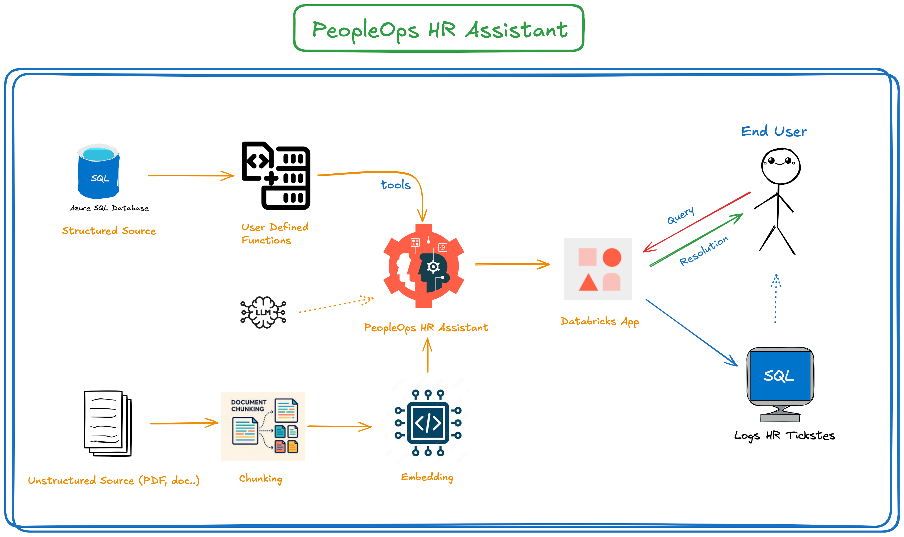
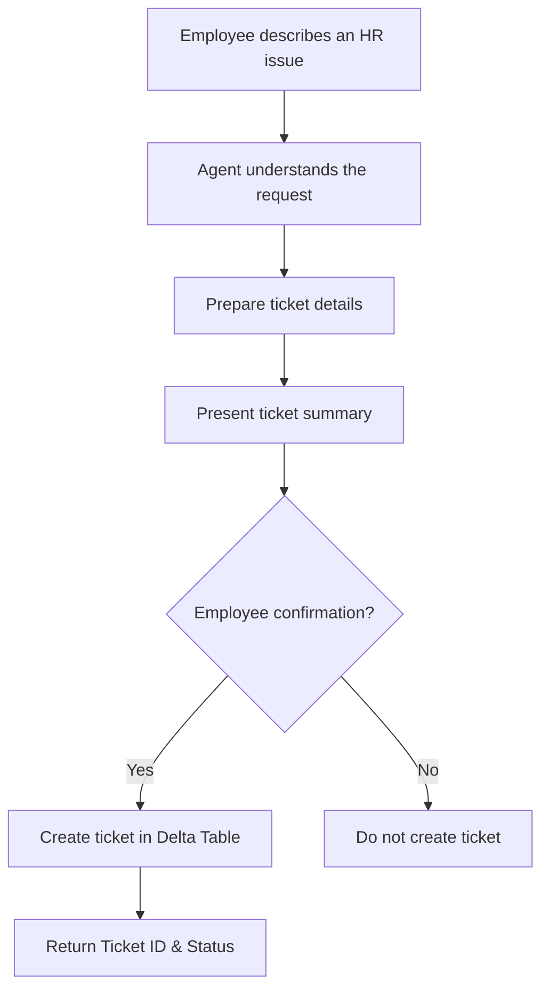

 
# 🤖 PeopleOps HR Assistant
### An AI-Powered HR Assistant Built with RAG, LangGraph & Databricks

<p align="center">
  <strong>Making HR information accessible, intelligent, and conversational.</strong>
</p>

<p align="center">
  
  
  
  
  
  
</p>

---

## 📌 Project Overview

Employees frequently struggle to access accurate HR information because company policies are distributed across multiple documents, employee information resides in structured databases, and HR support requests often require manual intervention.

Traditional HR support processes can lead to repetitive queries, delayed responses, and unnecessary workload for HR teams.

**PeopleOps HR Assistant** addresses these challenges through an AI-powered conversational assistant that combines Retrieval-Augmented Generation (RAG), Large Language Models (LLMs), agent-based orchestration, and structured SQL tools.

Employees can ask questions in natural language, retrieve relevant HR policy information, check their employee and leave details, and raise HR support tickets through a single conversational interface.

## 🎬 Project Demo

▶️ **Watch the complete project walkthrough on YouTube:**

[](https://youtu.be/EdR3X5RBDJo)

### 🎯 Project Objectives

- Centralize access to HR policy information.
- Provide context-aware answers using company HR documents.
- Retrieve employee information from structured databases.
- Enable employees to check their leave balances conversationally.
- Automate HR support ticket creation with employee confirmation.
- Build an observable and extensible AI agent application.

---

## ✨ Key Features

| Feature | Description |
|---|---|
| 📚 HR Policy Assistant | Answers HR-related questions using RAG over HR policy documents. |
| 🔎 Semantic Search | Retrieves relevant document chunks using Databricks Vector Search. |
| 👤 Employee Information | Fetches employee profile information from structured Delta tables. |
| 🗓️ Leave Balance | Retrieves employee leave entitlements, usage, and remaining balances. |
| 🎫 HR Ticket Creation | Creates HR support tickets after explicit employee confirmation. |
| 🧠 Intelligent Agent | Uses LangGraph and an LLM to select appropriate tools based on user queries. |
| 📊 Observability | Uses MLflow tracing and evaluation to inspect agent behaviour and performance. |
| 💬 Conversational UI | Provides an interactive employee experience through Streamlit. |

---

## 🏗️ Solution Architecture

The solution is organized into four major layers:

1. **Data Preparation:** Extract, clean, chunk, and generate embeddings from HR policy PDFs.
2. **RAG Retrieval:** Store embeddings and retrieve relevant HR policy chunks using Databricks Vector Search.
3. **Agent Orchestration:** Use LangGraph, an LLM, and specialized tools to handle employee queries.
4. **Application Layer:** Provide a conversational interface through Streamlit.

### Architecture Diagram

<p align="center">
  
</p>

> **Note:** Add your architecture diagram to the repository root and name it `architecture.png`, or update the image path above to match your actual filename.

### High-Level Architecture Flow

```mermaid
flowchart TD
    A["HR Policy PDFs"] --> B["Extract, Clean & Chunk"]
    B --> C["GTE Large EN Embeddings"]
    C --> D["Delta Embeddings Table"]
    D --> E["Databricks Vector Search"]

    F["Employee Question"] --> G["Streamlit Application"]
    G --> H["LangGraph Agent"]
    H --> I["Databricks GPT OSS 120B"]

    H --> J["HR Policy Retriever"]
    J --> E
    E --> K["Relevant HR Policy Chunks"]
    K --> H

    H --> L["Employee SQL Tool"]
    H --> M["Leave Balance SQL Tool"]
    H --> N["HR Ticket Tool"]

    L --> O["Databricks SQL Warehouse"]
    M --> O
    N --> P["HR Support Tickets Delta Table"]

    O --> Q["Employee & Leave Delta Tables"]

    H --> R["Final Conversational Response"]
    R --> G
```



---

## 🔄 How It Works

### 1. HR Document Processing – Data Preparation

HR policy documents are uploaded as PDF files and processed to prepare them for retrieval.

**Workflow:**

1. Load HR policy PDFs from a Unity Catalog Volume.
2. Extract document text using PyPDF2.
3. Clean and prepare the extracted content.
4. Split documents into smaller chunks.
5. Generate vector embeddings using the Databricks GTE Large EN embedding model.
6. Store document chunks and embeddings in Delta tables.

**Chunking configuration:**

| Parameter | Configuration |
|---|---|
| Chunk size | 700 characters |
| Chunk overlap | 100 characters |
| Embedding model | Databricks GTE Large EN |
| Embedding dimension | 1024 |
| Storage | Databricks Delta Tables |

The resulting embeddings are stored in:

`peopleopsproject.genai_book.hr_docs_embeddings_v2`

### 2. Retrieval-Augmented Generation – RAG

Databricks Vector Search enables semantic retrieval of relevant HR policy content.

**Retrieval workflow:**

1. Employee submits an HR policy question.
2. The question is converted into an embedding.
3. Databricks Vector Search retrieves relevant document chunks.
4. Hybrid search combines semantic and keyword-based retrieval.
5. The retrieved chunks are provided to the AI agent as context.
6. The LLM generates a response grounded in the retrieved information.

**Vector Search configuration:**

| Component | Configuration |
|---|---|
| Vector Search Endpoint | `peopleops_vs_endpoint` |
| Index | `peopleopsproject.genai_book.hr_docs_vs_index_v2` |
| Source Table | `hr_docs_embeddings_v2` |
| Embedding Model | `databricks-gte-large-en` |
| Search Type | Hybrid Search |
| Retrieval | Top 3 chunks |

### 3. AI Agent – LangGraph Orchestration

The LangGraph agent acts as the central decision-making component.

It uses Databricks GPT OSS 120B to understand employee questions, determine which tool is appropriate, retrieve information, and generate conversational responses.

**Available Agent Tools:**

| Tool | Responsibility | Data Source |
|---|---|---|
| `employee_details_tool` | Retrieves employee profile information. | `employees` |
| `leave_balance_tool` | Retrieves leave entitlements and balances. | `leave_balance` |
| `hr_policy_tool` | Searches relevant HR policy documents. | Vector Search Index |
| `create_hr_ticket` | Creates an HR support ticket. | `hr_support_tickets` |

The agent selects tools based on the employee's question rather than requiring employees to understand the underlying database or retrieval process.

### 4. Structured Data Access – Databricks SQL

Structured employee and leave information is retrieved through SQL tools connected to a Databricks SQL Warehouse.

**Delta tables:**

| Table | Purpose |
|---|---|
| `employees` | Stores employee profile information. |
| `leave_balance` | Stores leave entitlement, usage, and balance information. |
| `hr_support_tickets` | Stores HR support ticket details. |

The SQL tools allow the agent to retrieve structured information rather than relying on the LLM to guess employee-specific values.

### 5. HR Ticket Creation – Human Confirmation

The assistant supports HR support ticket creation through a confirmation-based workflow.

**Ticket creation process:**

1. Employee describes an HR issue.
2. Agent understands the issue and determines the ticket details.
3. Agent prepares the ticket category, subject, description, and priority.
4. Agent presents the proposed ticket details to the employee.
5. Employee explicitly confirms whether to create the ticket.
6. Only after confirmation does the ticket creation tool execute.
7. The created ticket ID and status are returned to the employee.



This workflow introduces a human confirmation step before a database write operation.

---

## 🧰 Technology Stack

| Category | Technology | Usage |
|---|---|---|
| Programming Language | Python | Application and backend development |
| Data Platform | Databricks | Data engineering and AI workloads |
| Data Storage | Delta Lake | Structured data and embedding storage |
| Document Processing | PyPDF2 | PDF text extraction |
| Embedding Model | Databricks GTE Large EN | Text embedding generation |
| Vector Database | Databricks Vector Search | Semantic and hybrid retrieval |
| LLM | Databricks GPT OSS 120B | Reasoning and response generation |
| Agent Framework | LangGraph / LangChain | Agent creation and tool orchestration |
| Database Access | Databricks SQL Connector | Structured data retrieval and ticket insertion |
| Frontend | Streamlit | Conversational user interface |
| Experiment Tracking | MLflow | Agent tracing and evaluation |

---

## 📂 Project Structure

The project contains notebook-based development and a separate application layer.

```text
📂 Project Structure

PeopleOps-HR-Assistant/
│
├── app/
│   ├── app.py                       # Streamlit application
│   ├── app.yaml                     # Databricks App configuration
│   └── peopleops_agent.py           # LangGraph AI agent and tools
│
├── hr-docs/
│   ├── Code_of_Conduct.pdf
│   ├── Holiday_Calendar_2026.pdf
│   ├── Hybrid_Work_Policy.pdf
│   ├── Leave_Policy_2024_SUPERSEDED.pdf
│   ├── Leave_Policy_2026.pdf
│   ├── Notice_Diwali_Holiday_scanned.png
│   └── Travel_and_Expense_Policy.pdf
│
├── images/
│   ├── Architecture.png             # Solution architecture
│   ├── ProblemStatement.png         # Business problem
│   └── Solution.png                 # Proposed solution
│
├── notebooks/                       # Databricks AI engineering notebooks
│
├── sample-data/
│   ├── employees.csv                # Sample employee records
│   └── leave_balance.csv            # Sample leave records
│
├── sql/
│   └── HR_Support_Ticket.sql         # HR support ticket table definition
│
├── .gitignore                       # Git exclusions and sensitive files
├── README.md                        # Project documentation
└── requirements.txt                 # Python dependencies
```

> The folder names above are a suggested organization for the GitHub repository. Adjust them to match the actual notebook and application filenames.

---

## 🚀 Getting Started

### Prerequisites

Before running the project, ensure you have:

- A Databricks workspace.
- Access to a Databricks SQL Warehouse.
- Access to Databricks Foundation Model endpoints.
- A configured Databricks Vector Search endpoint.
- Unity Catalog permissions for the required catalogs, schemas, tables, and volumes.
- Python installed.
- A Databricks authentication method configured.

### Step 1: Clone the Repository

```bash
git clone https://github.com/Prabhas92/PeopleOps_HR_Assistant
cd PeopleOps-HR-Assistant
```

### Step 2: Install Dependencies

Create a virtual environment:

```bash
python -m venv .venv
```

Activate it:

```bash
# macOS / Linux
source .venv/bin/activate

# Windows
.venv\Scripts\activate
```

Install dependencies:

```bash
pip install -r requirements.txt
```

### Step 3: Configure Databricks Resources

Configure the following resources in your Databricks workspace:

- Unity Catalog catalog and schema.
- HR policy document Volume.
- Employee and leave Delta tables.
- HR document chunks and embeddings tables.
- Databricks Vector Search endpoint and index.
- Databricks SQL Warehouse.
- GTE Large EN embedding endpoint.
- GPT OSS 120B foundation model endpoint.

### Step 4: Configure Authentication

Configure Databricks authentication using an approved authentication method, such as Databricks OAuth or a supported service principal.

Do not hardcode access tokens, passwords, or secrets in source code.

### Step 5: Run the Streamlit Application

```bash
streamlit run app.py
```

Open the local Streamlit URL displayed in the terminal.

> Databricks-hosted deployments may require additional application permissions, resource declarations, and environment configuration.

---

## 📊 Evaluation & Observability

The project includes an evaluation and tracing stage using MLflow.

The objective is to inspect the agent's behaviour and assess whether it retrieves relevant information, selects appropriate tools, and generates useful responses.

Areas of evaluation include:

- HR policy question answering.
- Retrieval relevance.
- Tool selection and execution.
- Response quality.
- Agent execution traces.
- Error handling and performance.

MLflow helps make the agent's execution more observable and supports iterative improvements.

---

## 🔐 Security Considerations

Since this application handles employee-related information, security and access control are important.

Key considerations:

- Use Databricks authentication and workspace permissions.
- Apply Unity Catalog access controls to tables and volumes.
- Avoid hardcoding credentials and access tokens.
- Use parameterized SQL queries.
- Restrict access to employee-specific records.
- Validate user identity before returning sensitive employee information.
- Require explicit confirmation before creating HR support tickets.
- Treat retrieved document content as untrusted input.

**Important:** Prompt instructions alone do not enforce authorization. Production deployments should implement identity-aware access control and server-side authorization checks for every employee-specific operation.

---

## 💡 Key Engineering Concepts Demonstrated

This project demonstrates practical implementation of several modern AI engineering concepts:

| Concept | Practical Implementation |
|---|---|
| Retrieval-Augmented Generation | HR document retrieval and grounded answers |
| Embeddings | Converting HR document chunks into vector representations |
| Vector Search | Hybrid retrieval of relevant policy chunks |
| Agentic AI | LLM-driven tool selection and execution |
| Tool Calling | Connecting the LLM to SQL and retrieval tools |
| Agent Orchestration | Managing the agent workflow using LangGraph |
| Structured Data Integration | Retrieving employee and leave information using SQL |
| Human-in-the-Loop | Confirming ticket creation before database insertion |
| Observability | Tracking agent execution using MLflow |
| Application Deployment | Exposing the agent through Streamlit |

---

## 🔮 Future Enhancements

Potential improvements for future iterations include:

- [ ] Identity-aware employee authentication and authorization.
- [ ] Conversation memory and context management.
- [ ] HR ticket tracking and status updates.
- [ ] Email notifications for ticket creation.
- [ ] Advanced document version management.
- [ ] Improved retrieval evaluation and reranking.
- [ ] Automated ingestion of newly published HR policies.
- [ ] Comprehensive agent evaluation datasets.
- [ ] Production-grade monitoring and error handling.
- [ ] Role-based access control for employees, managers, and HR administrators.

---

## 🎯 Project Outcome

PeopleOps HR Assistant demonstrates how traditional HR workflows can be enhanced using modern AI engineering techniques.

By combining structured SQL data access, RAG-based document retrieval, agent orchestration, and a conversational application, the solution provides a unified interface for common employee HR requirements.

It demonstrates an end-to-end approach to building an AI-powered enterprise assistant on Databricks, from document preparation and vector indexing to agent development, application deployment, and observability.

---

## 👨‍💻 Author

**Chethan Prabhas**

Azure Data Engineering | Databricks | PySpark | SQL | Generative AI

<p align="left">
  <a href="https://github.com/Prabhas92">
    
  </a>
</p>

---

<p align="center">
  <strong>⭐ If you find this project useful, consider giving it a star!</strong>
</p>

<p align="center">
  Built to explore the intersection of Data Engineering and Generative AI.
</p>
